<p align="center">
  
</p>

<h1 align="center">KhianKrub (เขียนครับ)</h1>

<p align="center">
  <b>A free, open-source word processor for Thai and English, for Mac and Windows.</b><br>
  โปรแกรมพิมพ์เอกสารฟรี โอเพนซอร์ส สำหรับภาษาไทยและภาษาอังกฤษ บน Mac และ Windows
</p>

<p align="center">
  <a href="https://github.com/chanonss/khiankrub/releases/latest"><b>⬇️ Download for Mac</b></a> ·
  <a href="https://github.com/chanonss/khiankrub/releases/latest"><b>⬇️ Download for Windows (64-bit)</b></a> ·
  <a href="FORK-CHANGES.md">What's new</a> ·
  <a href="#license-and-credits">Licence and credits</a>
</p>

<p align="center">
  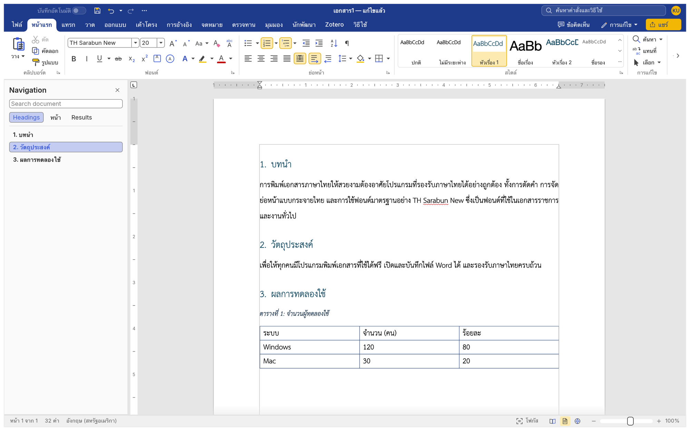
</p>

KhianKrub is a fork of [WordCraft](https://github.com/storytold/wordcraft) by the ArtCraft team, adapted for Thai
users by Chanon Sarasuk. It opens, edits and saves Word documents (`.docx`), with a ribbon laid out like Microsoft
Word's, and adds what Thai writing needs. It is not affiliated with or endorsed by the ArtCraft team.

This is a one-person project and still young. If something doesn't work, please
[open an issue](https://github.com/chanonss/khiankrub/issues); every report helps.

โปรแกรมพิมพ์เอกสารภาษาไทยที่ใช้ได้ฟรี ยังอยู่ระหว่างพัฒนา
หากพบปัญหา แจ้งได้ที่หน้า [Issues](https://github.com/chanonss/khiankrub/issues) ขอบคุณทุกความคิดเห็นครับ

## What's new in 0.8.0

### Thai menus

The ribbon, the title bar, the File page and the right-click menus can be in Thai. Choose **ไทย** in
File › Options › Language › Interface language; on a Mac or PC set to Thai, KhianKrub opens in Thai by itself.
Dialogs are still in English for now.

<p align="center">
  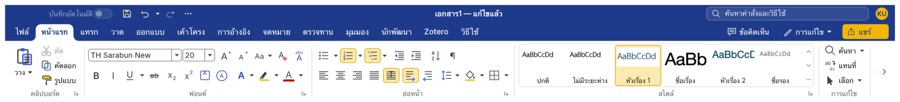
  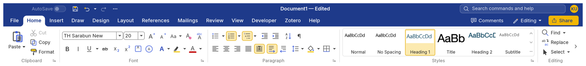
</p>

### A new look: navy and gold

The title bar and tabs are in KhianKrub's navy, from the app icon. The active tab joins the white ribbon with curved
corners, and buttons light up in the icon's gold when you point at them or turn them on. The dark theme follows the
same colours.

<p align="center">
  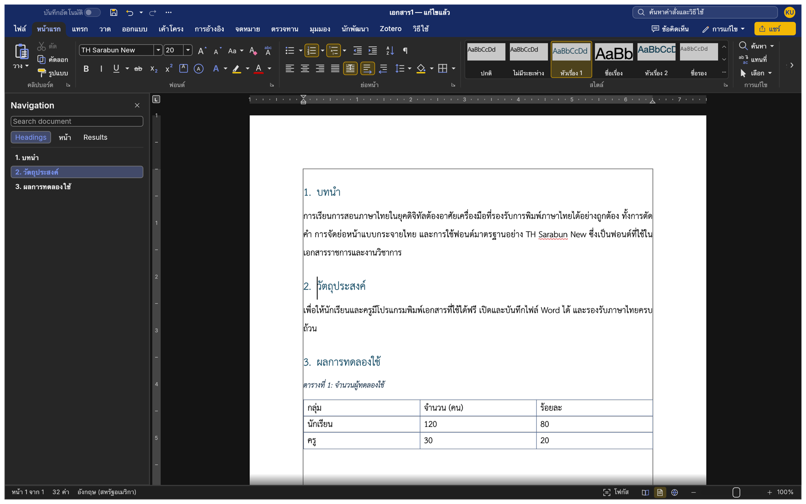
</p>

### Styles for Thai documents

<table>
<tr>
<td width="62%" valign="top">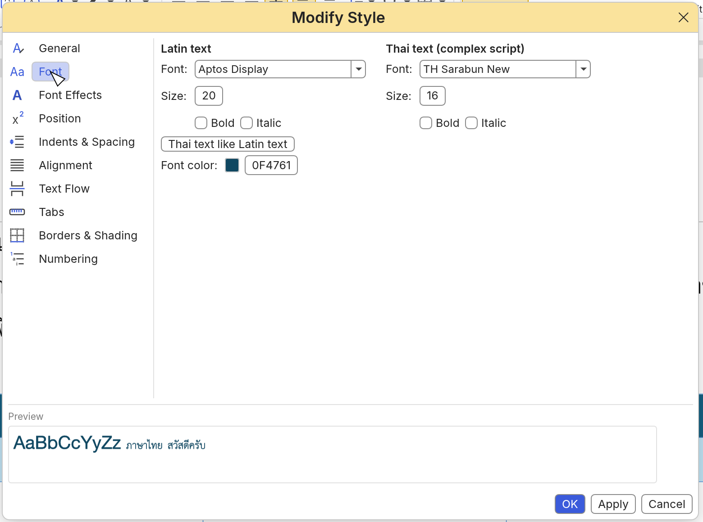<p align="center"><sub><b>Modify Style</b>, redesigned with ten pages. The font and size for Latin and Thai text side by side, so a heading can be TH Sarabun New 18 pt in Thai. <b>Apply</b> shows the change without closing the window.</sub></p></td>
<td width="38%" valign="top">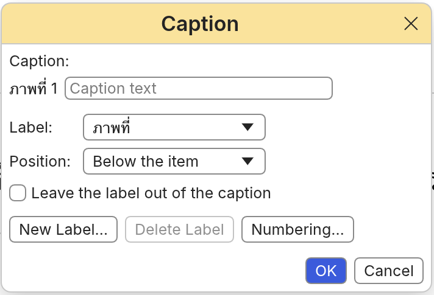<p align="center"><sub><b>Thai captions:</b> ภาพที่ and ตารางที่ are ready to use for pictures and tables.</sub></p>
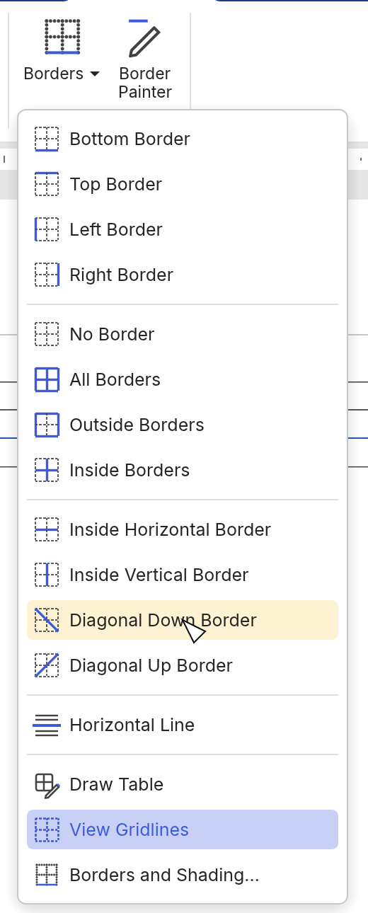<p align="center"><sub><b>Table borders</b> with a picture for each, now with diagonal lines, applied to the selected cells.</sub></p></td>
</tr>
</table>

### Numbered headings and multilevel lists

<table>
<tr>
<td width="45%" valign="top">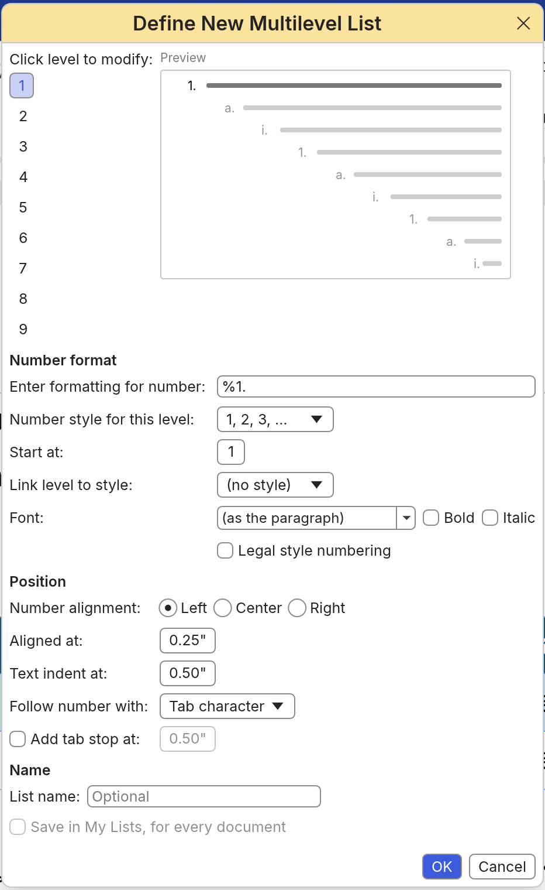</td>
<td width="55%" valign="top">

- **Link level to style:** Heading 1 numbers itself (1., 2., 3.) and the number takes the heading's look.
- **My Lists:** name a list you made and use it again in any document.
- The **Navigation pane** shows each heading with its number, as on the page.
- **Backspace or Delete** at the start of a numbered line removes the number and returns to Normal.

</td>
</tr>
</table>

### Smaller changes

- **TH Sarabun New** is the default font for new documents. If it isn't installed, KhianKrub offers the free
  download page.
- **Header and Footer** styles in the Styles gallery.
- **Thai Distribution** on the floating formatting bar that appears over selected text.
- **Several windows:** open more than one document at a time, each in its own window.
- Opening a file goes straight to the document; the Recover panel no longer gets in the way.
- **Windows and Mac downloads are built on GitHub.** From 0.8.0 the Mac download is one app for both Apple silicon
  and Intel Macs.

## Made for Thai

<table>
<tr>
<td width="50%" valign="top">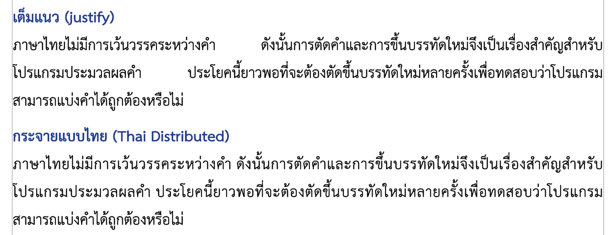<p align="center"><sub><b>Thai Distribution.</b> Justified Thai text with the extra space spread evenly, as in Word, instead of large gaps.</sub></p></td>
<td width="50%" valign="top">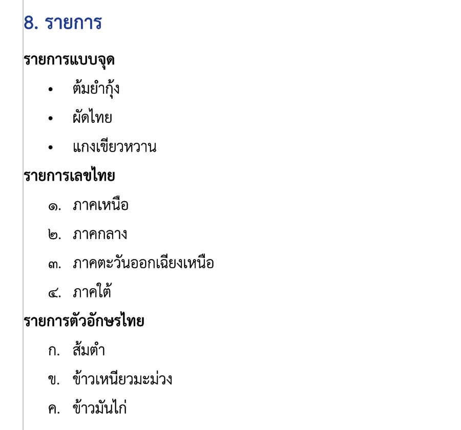<p align="center"><sub><b>Thai list numbering.</b> Thai digits (๑ ๒ ๓), Thai letters (ก ข ค) and Thai counting words, matching Word.</sub></p></td>
</tr>
<tr>
<td width="50%" valign="top">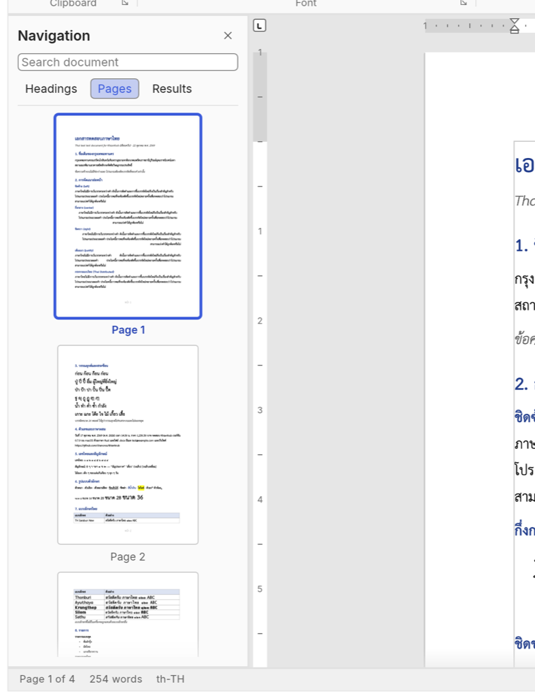<p align="center"><sub><b>Navigation.</b> Thai headings and page thumbnails; click one to go there.</sub></p></td>
<td width="50%" valign="top">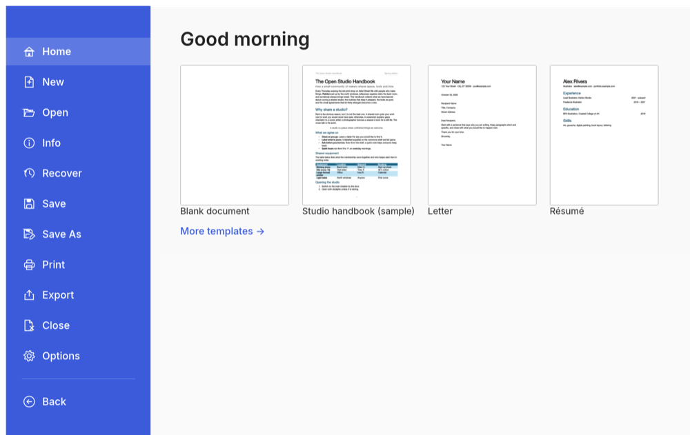<p align="center"><sub><b>File menu.</b> New, open, recover, save, print and export to PDF.</sub></p></td>
</tr>
</table>

- **Thai word breaking:** lines wrap between Thai words, even in long text without spaces.
- **Thai Distribution** alignment (Thai Distributed), on the Home tab next to Justify.
- **Thai list numbers, letters and counting words** in lists and page numbers.
- **Text boundaries:** a thin grey outline around the text area of each page (View › Show › Text Boundaries).
- **View only** mode in the Editing menu: read a document without changing it by accident.
- Thai text in documents, Thai fonts and Thai typing fully supported.

Everything that differs from the original, newest first, is in [FORK-CHANGES.md](FORK-CHANGES.md).

## Download and install

### Mac

1. Go to the [latest release](https://github.com/chanonss/khiankrub/releases/latest) and download
   the Mac zip (under *Assets*): **KhianKrub-…-macos-universal.zip** from 0.8.0 on,
   **KhianKrub-…-macos-apple-silicon.zip** in 0.7.3 and earlier.
2. Double-click the zip to unzip it, then drag **KhianKrub** into your **Applications** folder.
3. **First time only: right-click › Open.** The app is not signed by Apple, so macOS says it cannot verify the
   developer. Right-click (or Control-click) KhianKrub, choose **Open**, then click **Open** again. If the dialog
   only offers *Move to Trash*, open **System Settings › Privacy & Security** and click **Open Anyway** next to
   KhianKrub.

ดาวน์โหลดไฟล์ zip จากหน้า [Releases](https://github.com/chanonss/khiankrub/releases/latest) ดับเบิลคลิกเพื่อแตกไฟล์
แล้วลาก KhianKrub ไปไว้ในโฟลเดอร์ Applications ครั้งแรกที่เปิดให้คลิกขวาที่แอป เลือก Open แล้วกด Open อีกครั้ง

**Needs:** macOS 11 or later. From 0.8.0 the Mac download is one app for both Apple silicon (M1 or later) and
Intel Macs; 0.7.3 and earlier run on Apple silicon only.

### Windows

1. Go to the [latest release](https://github.com/chanonss/khiankrub/releases/latest) and download
   **khiankrub-…-windows-x64.msi** (under *Assets*), then double-click it.
2. **First time only: More info › Run anyway.** The installer is not signed yet (see [Code signing policy](#code-signing-policy)), so
   Windows says "Windows protected your PC". Click **More info**, then **Run anyway**, and click **Yes** when Windows asks for permission. KhianKrub is
   then in the Start menu.

To use it without installing, download **khiankrub-…-windows-x64-portable.zip** instead, unzip it and double-click
**KhianKrub.exe**.

ดาวน์โหลดไฟล์ .msi จากหน้า [Releases](https://github.com/chanonss/khiankrub/releases/latest) แล้วดับเบิลคลิกเพื่อติดตั้ง
ถ้าขึ้นหน้าต่าง "Windows protected your PC" ให้กด More info แล้วกด Run anyway

**Needs:** Windows 10 or 11, 64-bit (x64). There is no Windows on ARM or Linux build yet. The features are the same
as on the Mac, except the menu bar at the top of the screen, which is a macOS feature.

On both, Thai text looks best with a Thai font installed, such as TH Sarabun New.

## Code signing policy

KhianKrub is applying to [SignPath Foundation](https://signpath.org) for free code signing of its Windows
releases. Once the application is approved, Windows releases are signed under this policy: *Free code signing
provided by [SignPath.io](https://about.signpath.io), certificate by [SignPath Foundation](https://signpath.org).*
Until then the Windows installer is unsigned (see *Download and install*).

- **What is signed:** the Windows installer (`khiankrub-<version>-windows-x64.msi`) and the programs in it and in
  the portable zip (`KhianKrub.exe`, `wordcraft-cli.exe`). They are built from this repository's source by
  GitHub Actions ([`.github/workflows/release-files.yml`](.github/workflows/release-files.yml)) from a release
  tag; nothing built elsewhere is signed.
- **Team and roles:**
  - Committers and reviewers: [Chanon Sarasuk](https://github.com/chanonss)
  - Approvers (each release is approved by hand before it is signed): [Chanon Sarasuk](https://github.com/chanonss)
- **Based on WordCraft:** KhianKrub is a fork of [storytold/wordcraft](https://github.com/storytold/wordcraft),
  which publishes signed builds of its own.

### Privacy

This program will not transfer any information to other networked systems unless specifically requested by the
user or the person installing or operating it.

- **Update check (off unless you turn it on).** At its first start, the desktop app asks whether it may check for
  updates. Only if you choose **Check Automatically** (or turn on *File › Options › General › Check for updates
  when KhianKrub starts*) does it ask GitHub's API, at most once a day, for the latest release
  (`api.github.com/repos/chanonss/khiankrub/releases/latest`). **Help › Check for Updates** asks only when you
  click it. The request carries the app's version and nothing else from your computer: no documents, names or
  settings. GitHub's handling of the request is covered by the
  [GitHub Privacy Statement](https://docs.github.com/en/site-policy/privacy-policies/github-general-privacy-statement).
- **Everything else stays on your computer.** Zotero citations talk to Zotero on the same computer
  (`127.0.0.1`), and the automation channel for scripts and AI agents only listens on `127.0.0.1` when it is
  started on purpose.

## Earlier changes

Changes from earlier versions.

### Before and after

#### The ribbon, sized and spaced like Word's

Larger icons, and the buttons centred in each group with even spacing, on every tab.

<p align="center">
  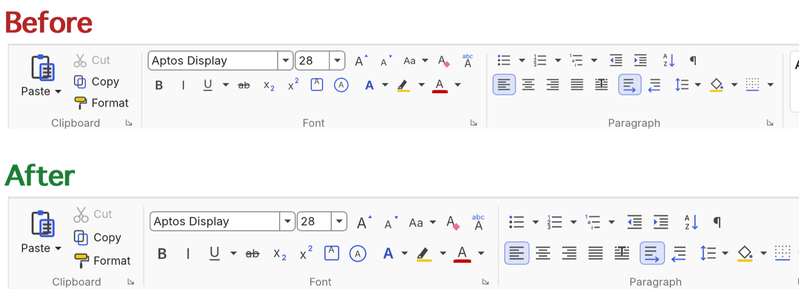
</p>

#### Bugs fixed

<table>
<tr>
<td width="35%" valign="top">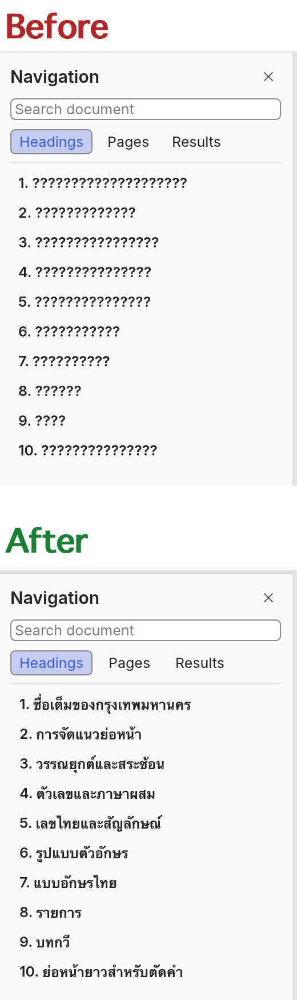<p align="center"><sub><b>Thai headings</b> in the Navigation pane showed as <code>?</code>; they now show in Thai.</sub></p></td>
<td width="65%" valign="top">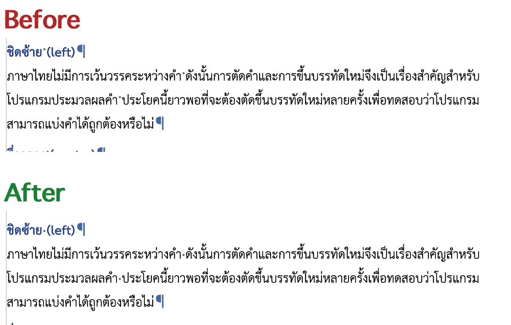<p align="center"><sub><b>Space marks on Thai text</b> (with ¶ on) floated near the top of the letters; they now sit in the middle.</sub><br><br></p>
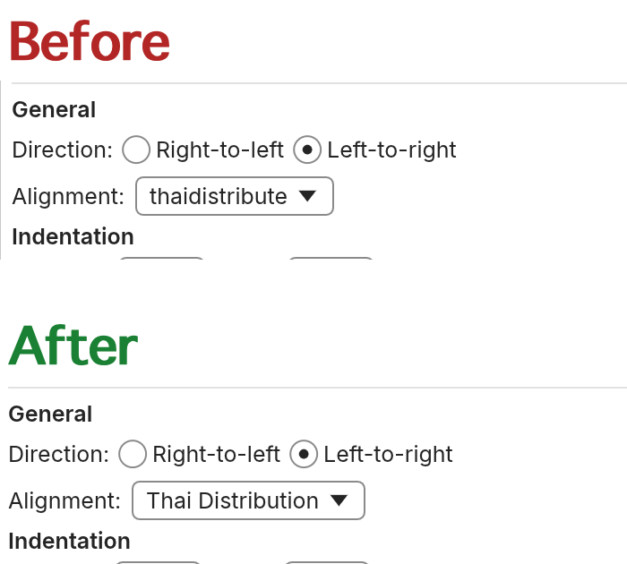<p align="center"><sub><b>Paragraph dialog</b> showed the raw name <code>thaidistribute</code>; it now says Thai Distribution and keeps it.</sub></p></td>
</tr>
<tr>
<td colspan="2">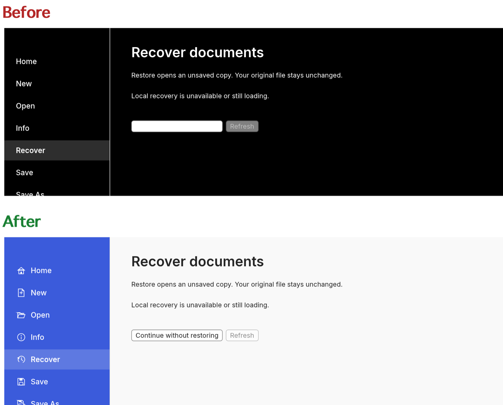<p align="center"><sub><b>File › Recover</b> was black with blank white buttons in the light theme; it now follows the theme like the other File pages.</sub></p></td>
</tr>
</table>

### More of what was added

<table>
<tr>
<td width="62%" valign="top">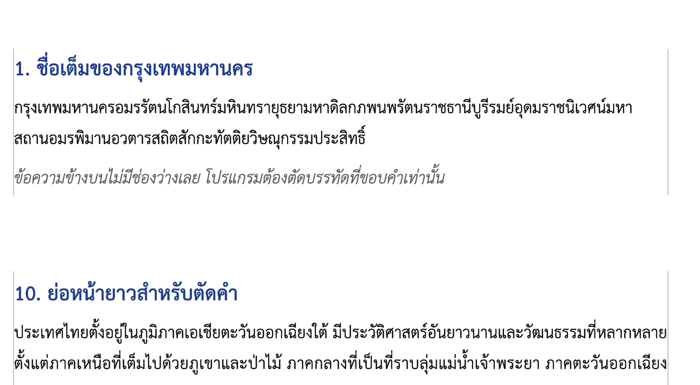<p align="center"><sub><b>Thai word breaking.</b> Lines wrap between Thai words, even in long text with no spaces at all.</sub></p>
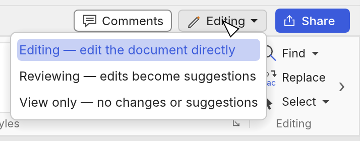<p align="center"><sub><b>View only</b> in the Editing menu: read a document without changing it by accident.</sub></p></td>
<td width="38%" valign="top">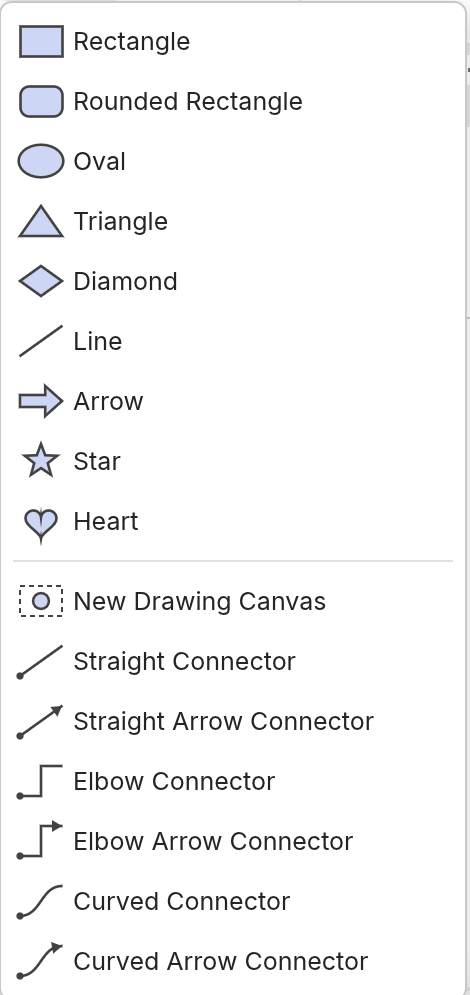<p align="center"><sub><b>Insert › Shapes</b> shows a picture of each shape and connector.</sub></p></td>
</tr>
</table>

### Earlier additions

#### A real macOS menu bar

File, Edit, Insert, Format, View, Window and Help at the top of the screen, with the usual Mac shortcuts. Each item
runs the same command as its ribbon button or key.

<p align="center">
  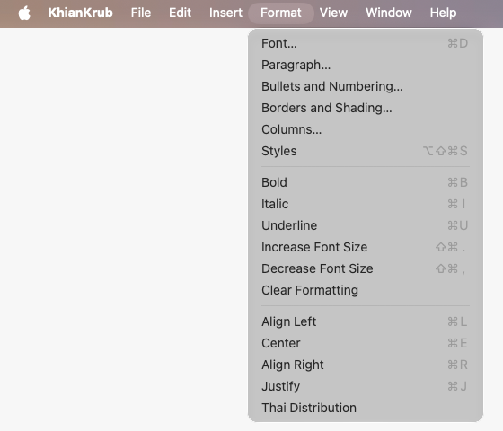
</p>

#### Page number at set distances from the paper's edges

Insert › Page Number › **Page Number Position…** places the number, for example, 1 inch from the top edge (to its
baseline) and 1 inch from the right edge, as theses often require. Top or bottom, left, centre or right, and no number
on the first page if wanted. Word opens the file with the number in the same place.

<table>
<tr>
<td width="50%" valign="top">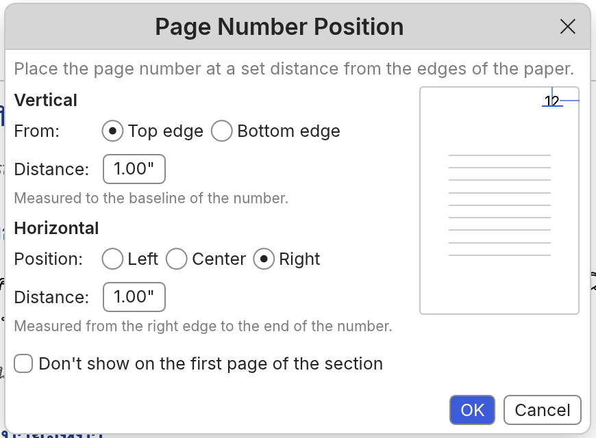<p align="center"><sub>The dialog, with a preview of where the number goes.</sub></p></td>
<td width="50%" valign="top">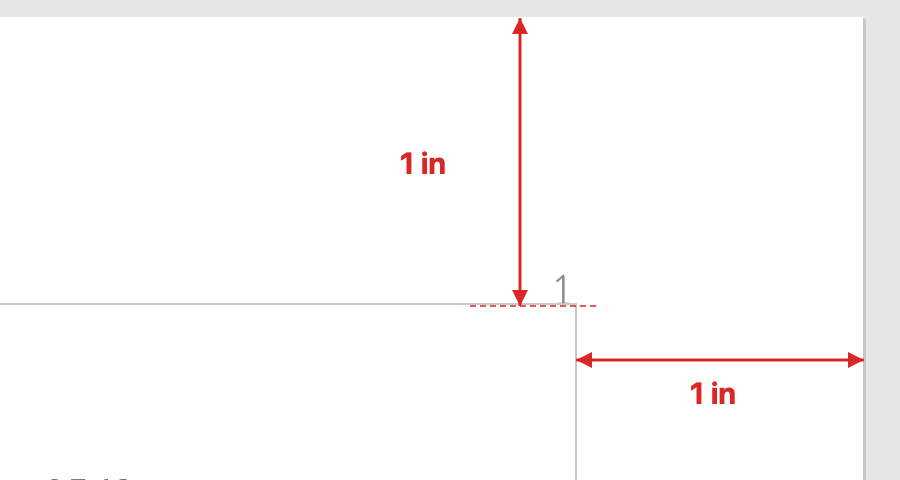<p align="center"><sub>The result, measured: 1 in from the top edge and 1 in from the right edge.</sub></p></td>
</tr>
</table>

#### Page breaks like Word's

Insert › Page Break (or ⌘Enter) moves the cursor to the next page, so what you type next goes there. With formatting
marks on, a page break shows as a dotted line with **Page Break** in the middle.

<table>
<tr>
<td width="50%" valign="top">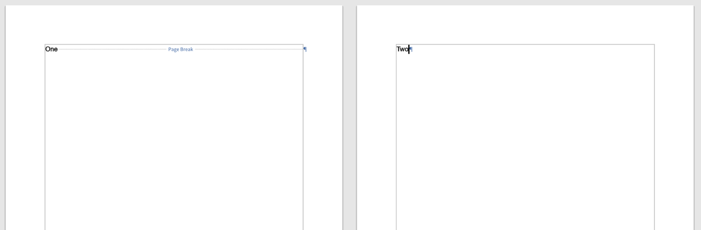<p align="center"><sub>"One", the break, then "Two" typed on page 2.</sub></p></td>
<td width="50%" valign="top">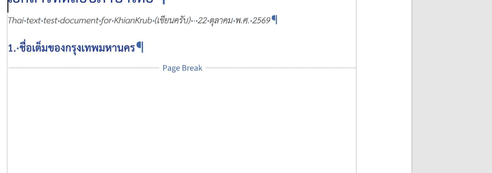<p align="center"><sub>The "Page Break" mark, as in Word.</sub></p></td>
</tr>
</table>

#### Hanging indent, as in Word

The Paragraph dialog has **Special: (none) / First line / Hanging** and **By**, instead of a negative first-line indent.

<p align="center">
  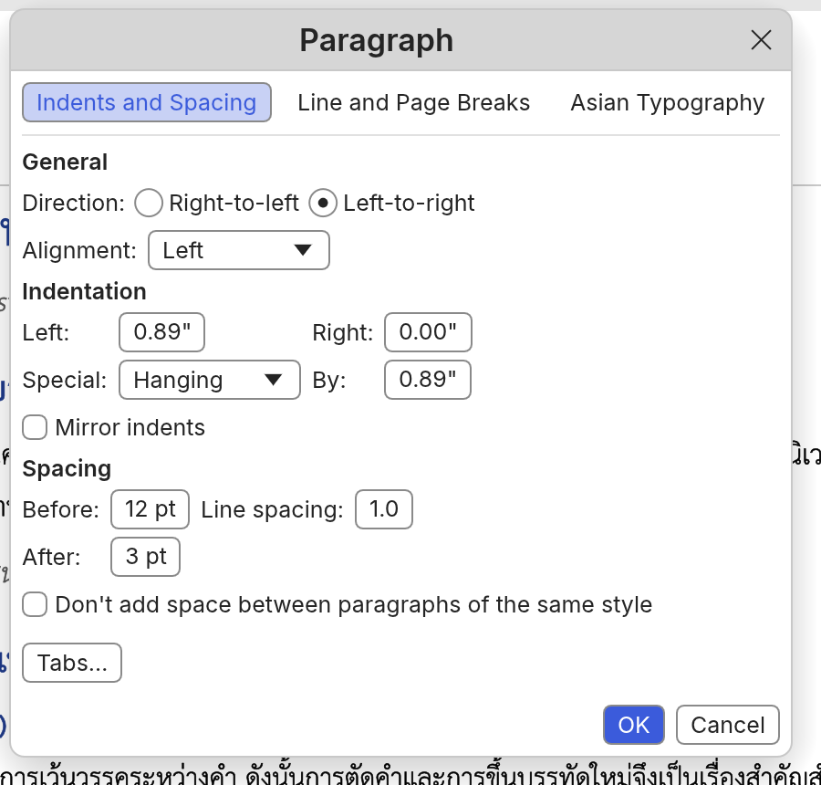
</p>

#### Pictures in the menus

The Layout tab's Text Direction, Orientation, Columns, Breaks and Line Numbers menus, and Insert's Table and Page
Number menus, show a small picture of each choice. The Insert Table grid is compact, as in Word.

<p align="center">
  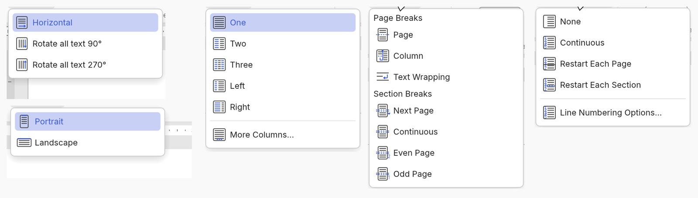
</p>
<p align="center">
  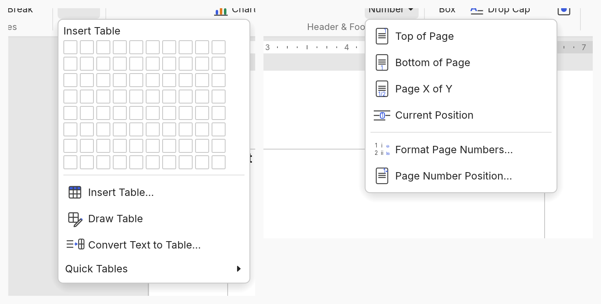
</p>

## Build it yourself

KhianKrub is written in Rust. With [Rust](https://rustup.rs) installed:

```bash
git clone https://github.com/chanonss/khiankrub.git
cd khiankrub
cargo build --release -p wordcraft
packaging/macos/local-app.sh
```

The last step makes `~/Applications/KhianKrub.app`. On Windows (with the Visual Studio C++ Build Tools and
[WiX v5](https://wixtoolset.org)), `packaging\windows\package.ps1 -Arch x64` builds the installer and the portable zip
into `dist\release`. `cargo xtask ci` runs all the checks (it also needs
`rustup target add wasm32-unknown-unknown`). The crates keep the original `wordcraft-*` names. The original
project's README, with its full documentation (command line, automation over MCP, architecture), is at
[storytold/wordcraft](https://github.com/storytold/wordcraft#readme).

## License and credits

KhianKrub, like WordCraft, is dual-licensed under [MIT](LICENSE-MIT) or [Apache-2.0](LICENSE-APACHE), at your option.
Copyright (c) 2026 ArtCraft Team and the WordCraft contributors; modifications copyright (c) 2026 Chanon Sarasuk.
Required notices are in [NOTICE](NOTICE).

**Based on [WordCraft](https://github.com/storytold/wordcraft) by the ArtCraft team.** Thank you to the ArtCraft
team and the WordCraft contributors, who wrote the program this fork builds on.

The icon's letter ข is traced from Sarabun Bold by Cadson Demak (SIL Open Font License 1.1). Bundled fonts, icons,
images and other assets keep their own open licenses; each one is listed with its author, source and license in
[ATTRIBUTION.md](ATTRIBUTION.md).

Thai word breaking uses [ICU4X](https://github.com/unicode-org/icu4x) by Unicode, Inc. (Unicode License v3);
its licence text and the list of its crates are in [NOTICE](NOTICE).

The English spelling dictionary and hyphenation come from Grady Ward's public-domain Moby
Hyphenator II word list. Polish spelling reads the Hunspell `pl_PL` dictionary installed on the system (not bundled) and
Polish hyphenation the TeX patterns by Hanna Kołodziejska, Bogusław Jackowski and Marek Ryćko (MIT
option). The sample documents and templates are original text written for WordCraft.

The ArtCraft name and logos are trademarks of the ArtCraft Team and are not covered by this license. This fork
does not include the ArtCraft logos: the original's brand license requires a modified version to remove them,
and allows saying in plain text that the work is based on WordCraft by the ArtCraft team. It is not an ArtCraft
product. The original's brand terms are at [LICENSE-brand.txt](https://github.com/storytold/wordcraft/blob/main/docs/brand/LICENSE-brand.txt).

<sub>Microsoft and Microsoft Word are trademarks of the Microsoft group of companies. KhianKrub is an independent,
open-source project and is not affiliated with, sponsored by or endorsed by Microsoft Corporation; the name is used
only to describe the workflows it is compatible with.</sub>
